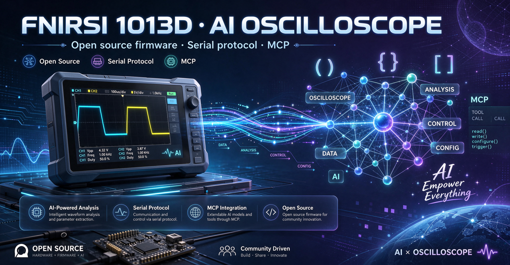

# FNIRSI 1013D Oscilloscope — AI Control Suite

> 🇨🇳 中文文档见 [`README.md`](README.md)。

Let any AI / script **fully drive** a FNIRSI / ADS 1013D tablet oscilloscope and read measurement values, waveform samples and the whole LCD screen that match the scope's own display **verbatim** — an "debug hardware while looking at the waveform" automation loop.

This repo ships: the **modified scope firmware source**, the **serial protocol**, **Python control library / bridge / screenshot tools**, an **AI Skill package**, an **MCP server**, plus flashing / build / beginner / usage docs.



---

## 1. Hardware & SoC

| Item | Value |
|---|---|
| Model | **FNIRSI / ADS 1013D** (dual-channel, 100 MHz tablet scope) |
| SoC | **Allwinner F1C100S** (ARM926EJ-S, `-mcpu=arm926ej-s`, 408 MHz) |
| LCD | **800 × 480, RGB565**, framebuffer `maindisplaybuffer` = 768,000 bytes in RAM |
| Acquisition | On-board FPGA, raw ADC code 0..255 (`128` = channel zero) |
| USB | CDC virtual serial, `VID 0x0483`, baud **2,000,000**, 8N1 |
| Mod firmware | `#VER` → `V1.3.0C MOD V9B4` |

## 2. What it can do
- **Control**: run/stop/single/autoset, timebase, volts/div, coupling, probe, channel on/off, trigger (source/mode/edge/level), UI language (this mod **adds Chinese UI**; upstream Atlan4 is English-only), simulated keys.
- **Read** `#MEAS`: on-screen measurement values verbatim (Vmax/Vmin/Vavg/Vrms/Vpp/Vp/Freq/Cycle/Time±/Duty±).
- **Read** `#WAV2,3`: 3000 sample points + 320-byte SysParam per frame.
- **Read** `#SHOT`: real full-LCD screenshot (menus/text/waveform) → PNG.
- **AI access**: CLI, Python library, AI Skill package, **MCP server**.

## 3. Quick start
```bash
pip install pyserial pillow
# flash the mod firmware (docs/FLASHING.md; prebuilt .bin in Releases), enable USB-Serial mode in menu
python skill/verify_protocol.py        # full self-test (37/37)
python host/scope_ai.py meas-stable    # recommended reading: freeze then read
python host/scope_ai.py shot screen.png
```
One-click: Windows `powershell -ExecutionPolicy Bypass -File .\run.ps1`; macOS/Linux `bash run.sh`.

## 4. Layout
```
firmware/src    modified scope source (#MEAS/#SHOT) + build & pack scripts
host/           scope_ai / scope_bridge / render_wave / tools
skill/          SKILL.md + PROTOCOL.md (self-contained AI skill package)
mcp/            runnable MCP server + client config example + offline test
docs/           BEGINNER · GETTING-STARTED · SOFTWARE-GUIDE · FLASHING · HARDWARE ·
                AI-USAGE · AI-PROMPT · ARCHITECTURE · TROUBLESHOOTING · CHANGELOG
assets/         cover, real scope screenshot, rendered waveform
run.ps1 / run.sh  one-click
```

## 5. Protocol (summary) — full spec in [`skill/PROTOCOL.md`](skill/PROTOCOL.md)
Commands start with `#`, end with `\n`. `#WAV2` is a long line, `#SHOT` returns a header then binary.

| Group | Commands |
|---|---|
| Read | `#VER` `#INFO` `#MEAS` `#READ` `#WAV2,3` `#SHOT` |
| Run | `#SET,RUN/STOP/SINGLE/AUTOSET` |
| Scale | `#SET,TDIV,<idx>` `#SET,CHx,VDIV,<idx>` |
| Channel | `#SET,CHx,ON/OFF/AC/DC/PROBE/POS` |
| Trigger | `#SET,TRIG,CHx/AUTO/NORMAL/SINGLE/RISE/FALL/LEVEL` |
| UI | `#SET,LANG,CN/EN` `#KEY,<K>` |

**Golden rules**: `#SET,STOP` before reading/capturing; trust `#MEAS` only; throttle ≥0.12s/frame; don't infer RUN/STOP from SysParam bytes.

## 6. How an AI calls this
- **MCP** (Claude/Cursor): point a client at `mcp/server.py` → tools `scope_info / scope_measure / scope_set / scope_capture / scope_screenshot`. See [`mcp/README.md`](mcp/README.md).
- **Skill**: hand the `skill/` folder to a skill-capable agent.
- **CLI / library**: `python scope_ai.py <cmd>` or `from scope_ai import ScopeAI`.
- **Paste-ready system prompt**: [`docs/AI-PROMPT.md`](docs/AI-PROMPT.md) — copy this into any agent:

```
You can control a FNIRSI / ADS 1013D oscilloscope (Allwinner F1C100S, 800x480 RGB565) over USB serial (VID 0x0483, 2000000 8N1). Commands start with '#' and end with '\n'.
READ: #VER, #INFO, #MEAS (screen-exact), #READ (320B SysParam), #WAV2,3 (3000 pts), #SHOT (full LCD).
CONTROL: #SET RUN/STOP/SINGLE/AUTOSET; TDIV,CHx VDIV/ON/OFF/AC/DC/PROBE/POS; TRIG source/mode/edge/LEVEL; LANG CN/EN; #KEY.
RULES: 1) #SET,STOP before reading/capturing. 2) Trust #MEAS only. 3) Throttle >=0.12s/frame. 4) Don't infer RUN/STOP from SysParam. 5) AUTOSET needs RUN.
MCP tools: scope_info / scope_measure / scope_set / scope_capture / scope_screenshot.
```

## 7. Screenshot caveat
`#SHOT` works; colors (R/B) and orientation are verified correct. The last ~2048 bytes are stably missing (host fills black). Proved unrelated to packet size/timeout/flush (the firmware already splits). Localization next step: a firmware-side byte counter. See [`docs/GETTING-STARTED.md`](docs/GETTING-STARTED.md).

## 8. Beginner / Troubleshooting / CI
New to all this? Start at [`docs/BEGINNER.md`](docs/BEGINNER.md). Errors? [`docs/TROUBLESHOOTING.md`](docs/TROUBLESHOOTING.md). CI runs the hardware-free MCP self-test on every push (see the status badge in README).

## 9. Upstream & License
Based on the open community **Atlan4** firmware; FatFs/font and other components keep their own licenses. muqiu2026's modifications and tooling: **MIT** (see `LICENSE`). Flashing carries a bricking risk — back up first; flashing may void warranty.

---
*⭐ if it helped. Issues & PRs welcome.*
