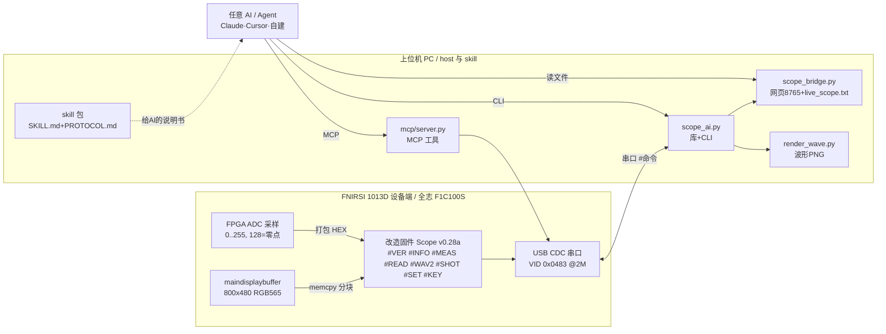

# 架构概览 · Architecture

## 分层
1. **固件层**（`firmware/src`）：在 Atlan4 Scope v0.28a 上加 `#MEAS`（复用屏幕同一组测量函数原样回传）、`#SHOT`（发整屏 RGB565 帧缓冲），并把命令路由到 `scope_control_dispatch`。
2. **协议层**（`skill/PROTOCOL.md`）：`#` 开头、`\n` 结尾的文本命令；`#WAV2` 为长行、`#SHOT` 头后跟二进制。含 SysParam 320B 偏移、档位表、帧格式。
3. **上位机层**（`host/`）：`scope_ai.py` 封装读/控/截图；`scope_bridge.py` 桥网页+实时文件并内置节流；`render_wave.py` 用 #WAV2+#MEAS 重绘真实坐标波形。
4. **AI 层**：CLI（subprocess）、Python 库、Skill 说明书、MCP server 四种入口，让 AI 看/读/调同一台机器。

## 数据通路要点
- **读数只走 #MEAS**：屏幕 Vavg/Vrms 经固件内部 `dcoffset/adc1compensation/dc_shift_size` 校准链（不在 320B 参数里），采样自算跨档必偏；#MEAS 是"屏幕原值"。
- **整屏走 #SHOT**：固件把 `maindisplaybuffer` 经 32KB 环形缓冲分块(现 4096B)发出；稳定少最后 ~2048B(≈1.3行)，上位机容错按黑补齐（与分包/超时无关，详见 README §7）。
- **采样走 #WAV2,3**：320B 参数 + CH1/CH2 各取前 3000 点；每点秒 = `#MEAS Cycle / 实测每周期点数`（≠ sample_dt）。
- **时序铁律**：读/抓前 STOP 冻结；抓帧节流 ≥0.12s；RUN 态连抓会撕裂。

## 构建 / 发布
- 编译：`firmware/build_firmware.ps1`（GCC14 arm-none-eabi，-O3）。
- 打包：`firmware/pack_firmware.py`（复刻 mksunxi + flashfilepacker）→ `fnirsi_1013d_control.bin`。
- 刷机：loader / sunxi-fel（见 FLASHING.md）。预编译产物见 **Releases**。
