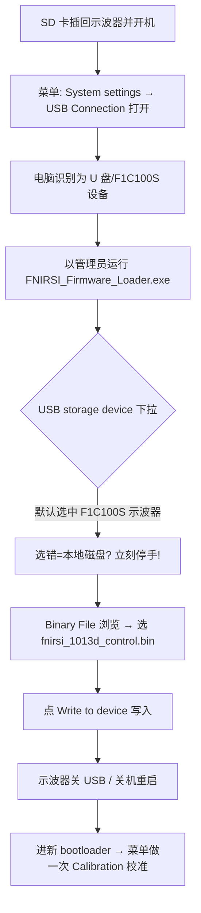
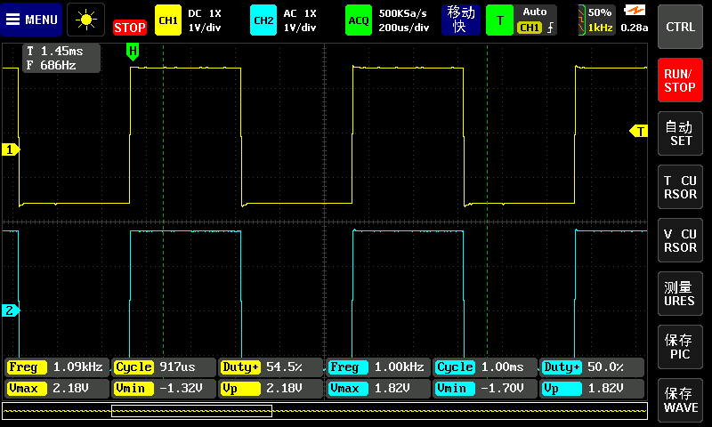
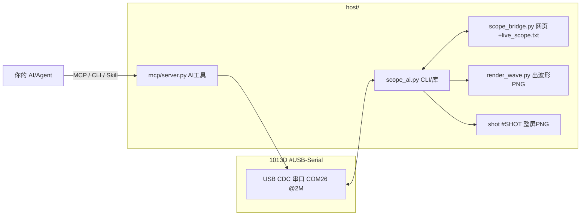
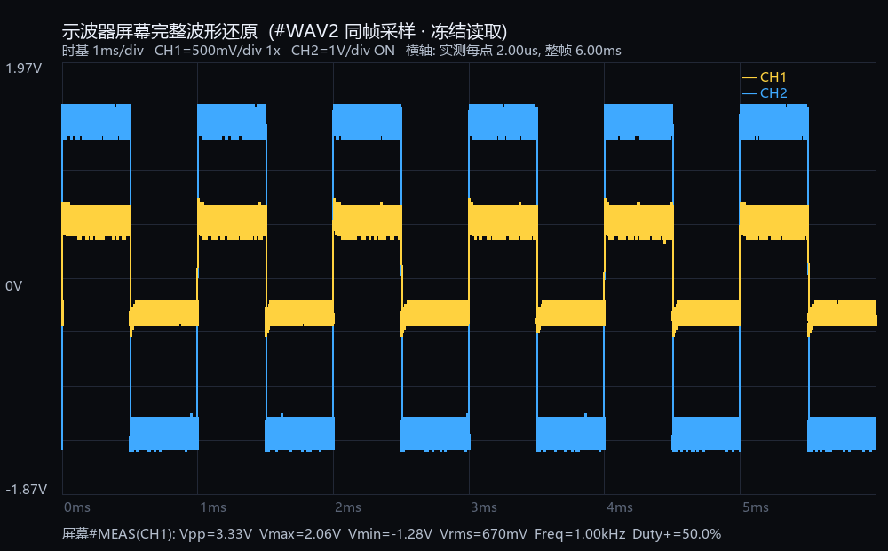

# 软件使用说明（图文并茂）· Software Guide

本仓库涉及的**软件工具**有 5 个，本文逐个说明：干什么用、怎么打开、关键界面在哪、和谁配合。流程图用 GitHub 原生 mermaid 渲染。

| 软件 | 类型 | 何时用 |
|---|---|---|
| `FNIRSI_Firmware_Loader.exe` | Windows 刷机工具 | **刷固件**（首次安装/恢复）|
| `sunxi-fel` | Linux 命令行 | 刷固件（FEL 方式，备选）|
| `FNIRSI1013D-APP-beta10.html` | 浏览器网页 APP | 连电脑实时看波形（Web Serial）|
| `host/scope_ai.py` | 命令行 + Python 库 | 人 / AI **控制与读数** |
| `host/scope_bridge.py` | 本地网页 + 实时文件 | 人看网页、**AI 读文件** |

---

## 1. FNIRSI_Firmware_Loader.exe —— Windows 刷固件工具

**它就是 Windows 下把固件写进示波器的那个工具**（来自社区 loader v1.1.3）。本仓库的 Releases 里已打包好，下载即用。

### 1.1 它安全吗（官方 readme 真实要点）
- 直接写**物理扇区**，但内置保护：**不**列出"非 USB / 被识别为硬盘 / 非 512B 扇区 / 含系统卷"的设备；只允许写 FAT32 且隐藏扇区数足够的卡。
- 需要管理员权限；用管理员账户时它会**自行提权**（可能弹一次 UAC）。
- 纯 Delphi VCL + Win32API，**不写注册表、不写文件系统**，无第三方库；兼容 Windows XP SP3 ~ Windows 11（32/64 位）。

### 1.2 刷固件流程



### 1.3 界面关键控件（从上到下）
- **USB storage device**：下拉选设备；程序会**默认选中名为 F1C100S 的示波器**。⚠️ 这一步选错会写错盘，务必确认选的是示波器而非 C/D/E。
- **Binary File + 浏览**：选择要刷的 .bin。
- **Write to device**：执行写入。
- **Boot Mode 页**：设置加载哪个固件 / 是否显示 boot 菜单（一般不动）。
- **Calibration 页**：保存/加载/清除校准数据（`.cal`）。
- 小技巧：只读/灰掉的输入框，**双击其文字标签**可解锁编辑。

> 最佳实践（官方建议）：把 `FNIRSI_Firmware_Loader.exe` 和固件 .bin **放同一文件夹**再运行；写完不必"安全弹出"，程序即时落盘。

---

## 2. 刷完后的示波器界面（真实截图）

刷入本改造固件、并打开 USB-Serial 后，屏幕长这样（用 `#SHOT` 直接从设备抓的真实 LCD）：



- 顶部菜单条：MENU / 亮度 / RUN-STOP / CH1 DC·1X / CH2 AC·1X / ACQ / 采样率 / 触发 / 电池。
- 右侧按钮列（CTRL 翻页）：CTRL / RUN-STOP / 自动 SET / CURSOR / 测量 / 保存 PIC / 保存 WAVE。
- 主区：CH1 黄、CH2 青方波 + 网格；底部黄底为实时测量条。
- 完整菜单中英对照见 [`示波器菜单中英对照.txt`](示波器菜单中英对照.txt)。

> ⭐ 中文界面是**本项目改造版新增**（上游 Atlan 只有英文），可用 `#SET,LANG,CN/EN` 运行时切换。

---

## 3. PC 实时波形 APP（浏览器）

`FNIRSI1013D-APP-beta10/FNIRSI 1013D-APP-beta10.html`：用 Chrome/Edge 打开，点 **CONNECT** 选串口 → **START** 实时看波形（Web Serial）。示波器端要关掉菜单，否则控制命令被拦截。

本项目另有一个更轻的界面素材 `assets/示波器波形界面重建.html`，可本地打开预览布局。

---

## 4. 本项目上位机：scope_ai / scope_bridge / render_wave / shot

这是"让 AI 接管"的主力，全部在 `host/`（`skill/` 内有同名可自包含副本）。



### 4.1 自检（第一步永远做这个）
```bash
python skill/verify_protocol.py     # 全命令自检，实测 37/37 通过
```

### 4.2 scope_ai.py：控制 + 读数
```bash
python host/scope_ai.py status          # 设置+波形+测量 完整 JSON
python host/scope_ai.py meas-stable     # ★读数(先冻结,与屏幕一致)
python host/scope_ai.py set timebase 1ms
python host/scope_ai.py set vdiv CH1 500mV
python host/scope_ai.py run / stop / single / autoset
python host/scope_ai.py view "2kHz 3.3V 方波"   # 一句话调到目标信号
python host/scope_ai.py report          # 人/AI 可读文本报告
python host/scope_ai.py shot 屏幕.png   # 整屏截图(需#SHOT固件)
```

### 4.3 render_wave.py：还原波形图
```bash
python host/render_wave.py            # 冻结读 #WAV2 + #MEAS，画示波器风格 PNG
```
产物示例（真实电压曲线 + 网格 + 屏幕测量值叠加）：



### 4.4 scope_bridge.py：人看网页 + AI 读文件
```bash
python host/scope_bridge.py           # 浏览器 http://localhost:8765 看实时波形
```
同时把实时数据写进同目录 `live_scope.txt`，顶部就是"屏幕测量值·固件 #MEAS 原值(权威)"段，任何 AI 直接读该文件即可；已内置节流防屏幕跳闪。

### 4.5 怎么让 AI 接管（三选一，详见 docs/AI-USAGE.md）
- **MCP**：把 `mcp/server.py` 配进 Claude/Cursor → AI 直接调用 `scope_measure / scope_set / scope_capture / scope_screenshot` 等工具。
- **Skill**：把 `skill/` 交给支持 SKILL 的 Agent。
- **CLI**：任何能跑命令行的 Agent 调 `python host/scope_ai.py <子命令>`。

---

## 5. 选型建议

| 你想做什么 | 用哪个 |
|---|---|
| 第一次刷固件 | FNIRSI_Firmware_Loader.exe（Linux 用 sunxi-fel）|
| 在电脑上实时看波形 | FNIRSI1013D-APP-beta10.html 或 scope_bridge.py |
| 拿和屏幕一致的测量值 | `scope_ai.py meas-stable`（或 MCP `scope_measure`）|
| 要一张当前波形图 | `render_wave.py` |
| 要真实屏幕截图(含菜单) | `scope_ai.py shot` |
| 让 AI 自动调+读+判断 | MCP server（见 §4.5）|
